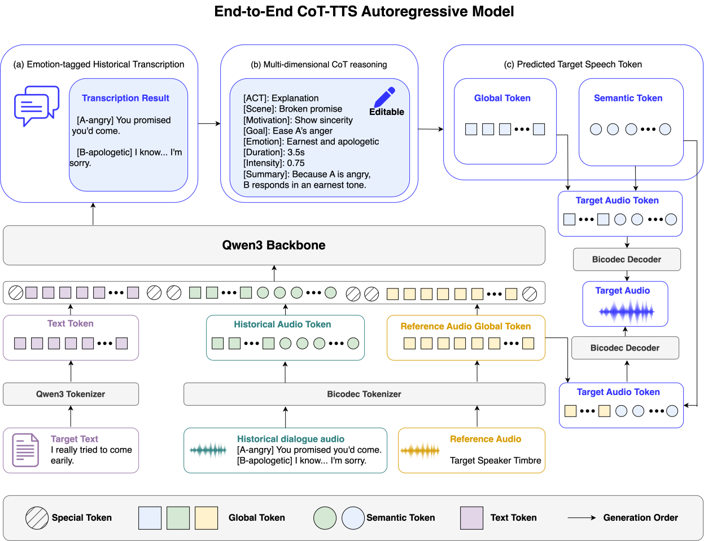
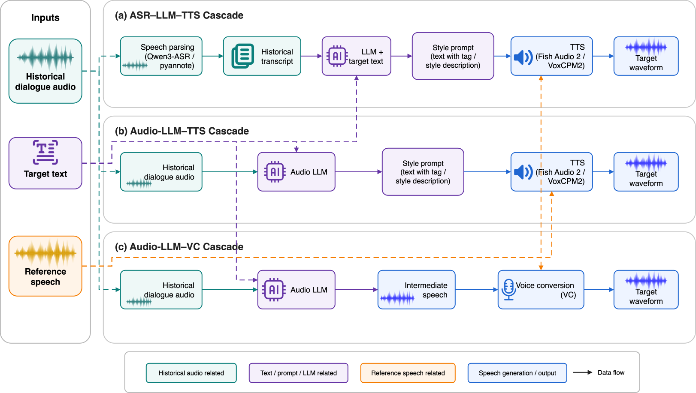

# COT-TTS Demo Gallery

This folder contains a self-contained static website for the COT-TTS demo gallery.

COT-TTS studies context-aware reasoning speech generation. Given historical dialogue audio, target text, and a reference speaker utterance, the system first understands the dialogue context, then produces explicit chain-of-thought reasoning about the intended speaking manner, and finally generates target speech with the target speaker timbre.

The demo page gives a lightweight overview of the project and provides listening examples for both the model and baseline systems.

## Model Overview

### Model



### Baseline



## Open Resources

- Proposal: https://arxiv.org/abs/2606.21933
- Challenge website: https://iscslp2026-cot-tts.github.io/challenge-website/
- Training Dataset: https://huggingface.co/datasets/HKUSTAudio/ISCSLP2026-CoT-TTS
- Evaluation data: https://huggingface.co/datasets/HKUSTAudio/ISCSLP2026-CoT-TTS/tree/main/eval-dataset
- Infer code: https://github.com/LuckyBian/COT-TTS/tree/main/infer
- Training code: https://github.com/LuckyBian/COT-TTS/tree/main/train
- Data construction: https://github.com/LuckyBian/COT-TTS/tree/main/data%20construction
- Challenge baseline: https://github.com/iscslp2026-cot-tts/baseline
- COT-TTS paper: https://github.com/LuckyBian/COT-TTS/blob/main/TASLP_2026_Final.pdf

## Local Preview

```bash
python -m http.server 8898
```

Then open:

```text
http://localhost:8898
```

## GitHub Pages

Upload all files in this folder to a GitHub repository. The entry file is:

```text
index.html
```

No backend or build step is required.

## Fixed Neutral Reference Demo

Between the emotion showcase and the Demo Table, this section presents five
Chinese and five English examples. Each language group shares one neutral
reference recording for global-token conditioning, alongside each case's
historical audio, target text, and generated output. The comparison highlights
expressive variation across dialogue contexts while the reference stays fixed.

`neutral-reference-demo-data.js` defines the selected cases. Audio files in
`neutral-reference/` are copied unchanged from the manually curated
`non-emo-ref-selected` folder; the page uses its five remaining audio pairs per
language rather than its older selection manifest.

## Audiobook Continuation Demo

The audiobook section sits between the representative cases and editable control demos.
`audiobook-demo-data.js` defines ten sentence clips in `audiobook/`: sentences
001–004 are original audiobook audio used as initial history and speaker reference;
005–010 are COT-TTS outputs. Each output uses all preceding sentences as history.

The full-passage player concatenates 001–010 without added gaps. Each generated
sentence also has an expandable player for its accumulated history
(`history-before-005.wav` contains 001–004, through
`history-before-010.wav` containing 001–009). The original sentence clips are
copied unchanged; concatenated files preserve their 16 kHz mono PCM samples.
